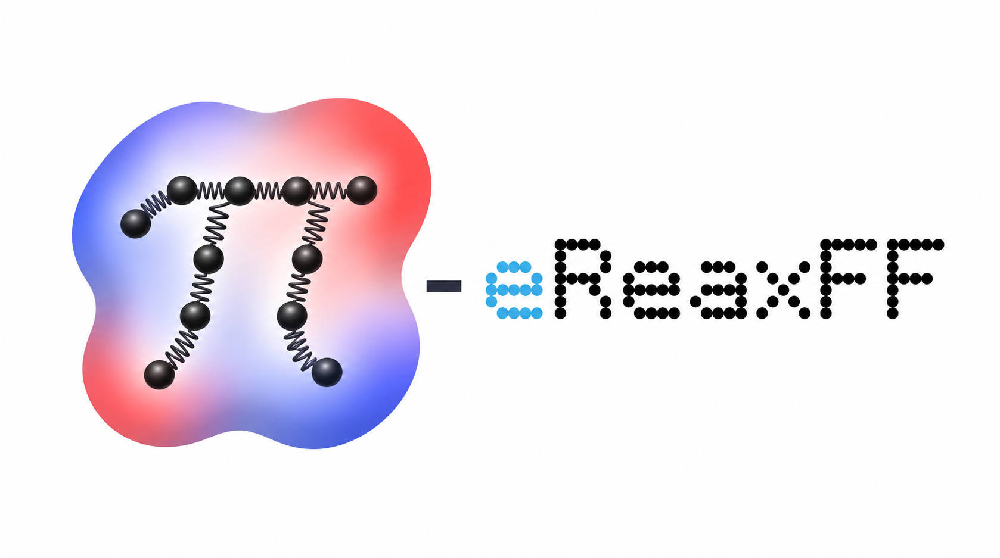
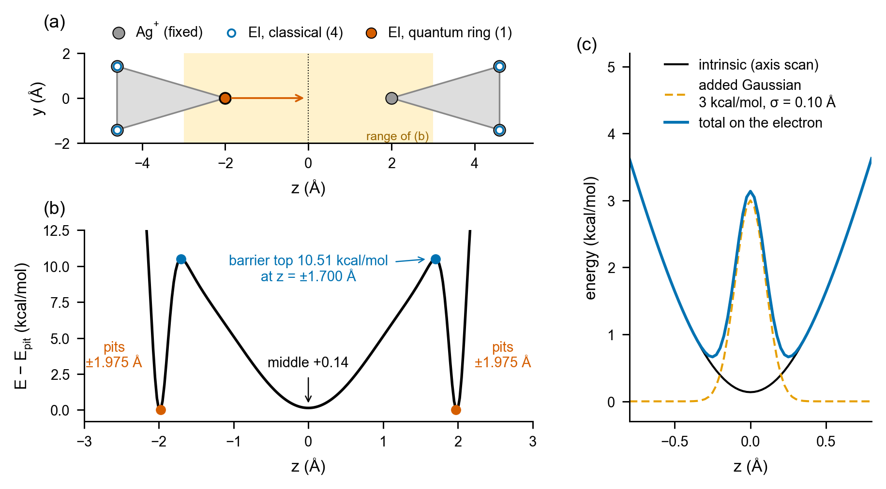
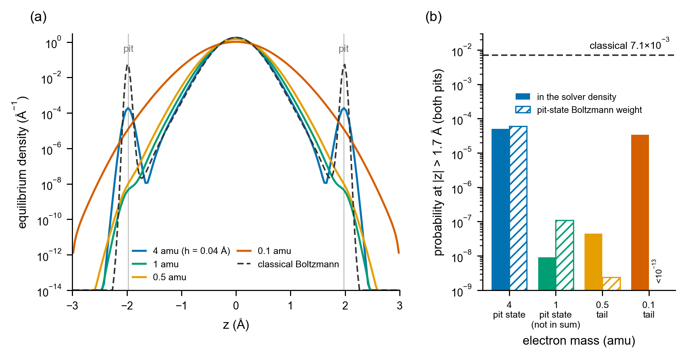
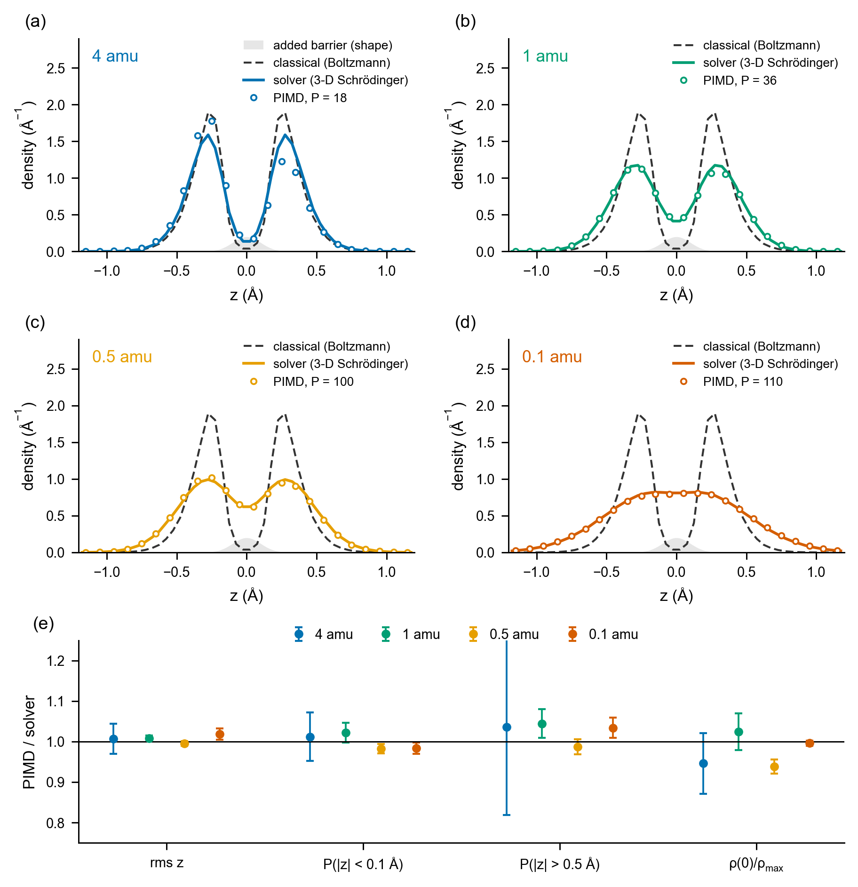
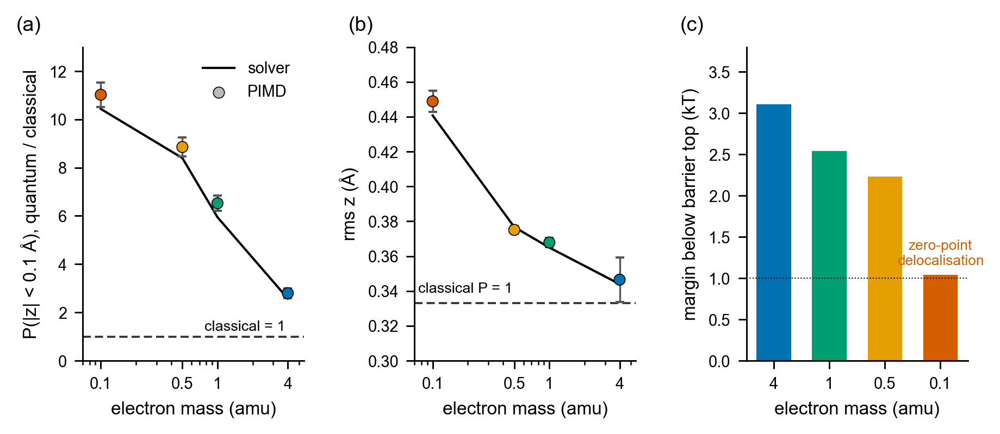
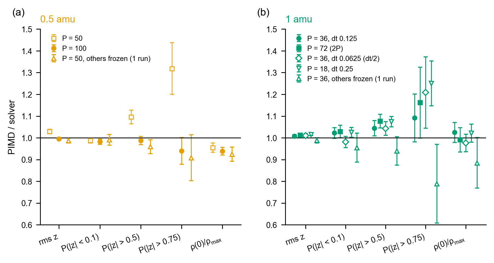
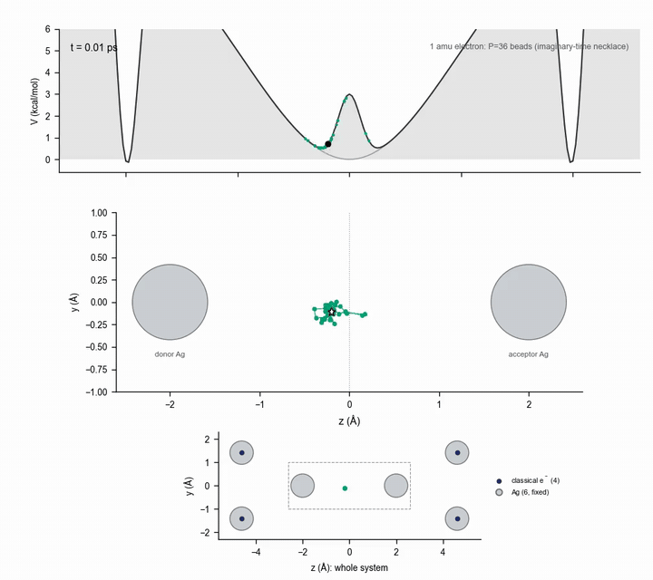
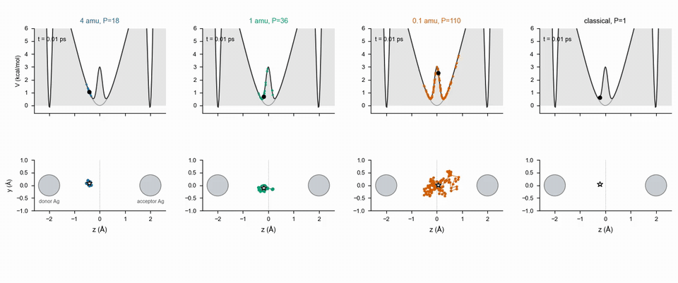
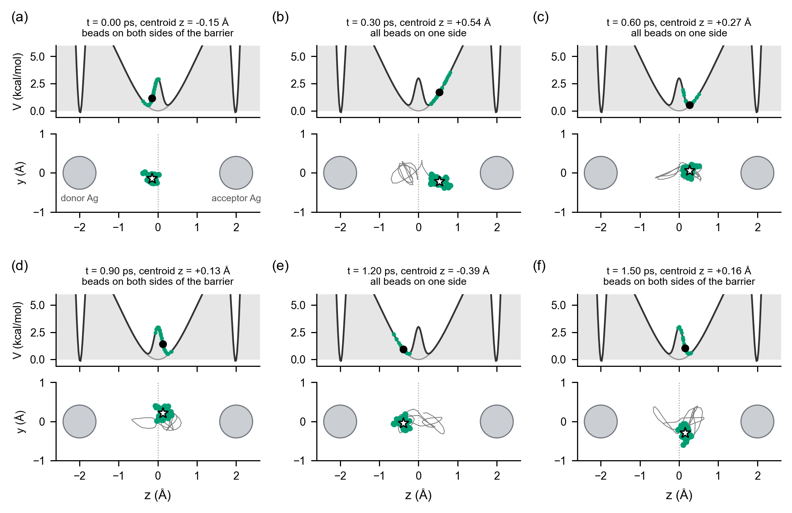

<p align="center">
  
</p>

# PI-eReaxFF

**What if an electron in a molecular-dynamics simulation could behave like a quantum particle, and still be cheap enough to simulate for nanoseconds?**

This project tries to make that real. It lets an electron tunnel through a barrier, spread out, and "leak" across a gap, inside a ReaxFF-style force field, using path-integral molecular dynamics.

> **Status in one line:** it works end to end for silver clusters with explicit electrons (Ag/El), and we have checked it against an independent quantum solver. It is not yet a general-purpose engine. [What works and what doesn't](#where-things-stand) is below. The repository is private and the license is undecided.

---

## The big picture

**ReaxFF** is a fast way to simulate chemistry: atoms, bonds that form and break, charges. It treats every atom classically.

**eReaxFF** adds one trick. Some electrons become particles of their own (type `El`) that move around between atoms. Now the model can describe things plain ReaxFF cannot: conduction electrons, electron transfer, an electron sitting in a gap.

But an electron is light, and a light particle is not a classical dot. It is smeared out, and it can slip through barriers it doesn't have the energy to climb. A normal simulation misses all of that.

**Path-integral molecular dynamics (PIMD)** fixes it with a neat trick. Replace each quantum particle with a **necklace of beads** joined by springs:

```
   classical particle            quantum particle (a ring polymer)

          •                            •───•───•
                                     •           •
     one point,                      •           •      the more spread out the necklace,
     one place                         •───•───•        the more "quantum" the particle

   a light particle = a big floppy necklace;  a heavy one = a tight little clump
```

Simulate the necklace with ordinary dynamics and you get the quantum statistics of the particle (zero-point motion, tunneling, delocalisation), for the cost of running many copies of the classical system.

**This repository connects the three pieces:**

```
        i-PI                     LAMMPS + Metal-Reax                eReaxFF force field
   (moves the beads,   <--->   (computes forces on every   <--->   (the physics: atoms, ions,
    keeps temperature)          bead, fast)                          explicit electrons)
```

- **i-PI** is the well-known PIMD driver. We added one feature: some atoms (the silver ions) can stay classical while the electron is a necklace.
- **Metal-Reax** is a fast ReaxFF engine written in C++. We added an eReaxFF mode, checked term by term against the original Fortran code.
- **The glue**: scripts, quantum solvers for cross-checking, and a pile of validation reports.

## Why bother?

The motivating problem is **electron leakage across thin barriers** (think silicon devices). Classical simulations say the electron stays put. Reality says it leaks. A force field with a PIMD electron should capture that. Before trusting it on silicon, we needed a clean test where the right answer is known. That is the demonstration below.

## The story so far: can a simulated electron tunnel?

### Chapter 1: the stage

We built the smallest system that has the physics we care about: **two silver triangles facing each other across a 4.0 Å gap**, with **one quantum electron** that can sit on either side. Six silver atoms are held fixed, four more electrons sit on the outer atoms as ordinary classical particles, and the fifth electron is a ring polymer (a necklace of beads, see above).



*Fig. 1. (a) The six fixed Ag atoms (grey), four classical electrons (blue rings) on the outer atoms, and the one quantum electron (orange), which starts at the left inner silver atom and is free to move along the axis. (b) The energy the electron feels along the axis: a narrow pit at each inner silver atom (z = ±1.975 Å), a 10.5 kcal/mol barrier on each side of the pit, and a broad shallow well in the middle. (c) Zoom on the middle, showing the Gaussian barrier we later add at z = 0.*

### Chapter 2: our first idea did not work (and that was informative)

The force field already has a built-in 10.5 kcal/mol barrier between each pit and the middle, so we hoped the electron would sit in one pit and tunnel to the other. Before running anything expensive, we asked the quantum solver where the electron actually wants to be.



*Fig. 5. (a) Equilibrium density along the axis from the 3-D Schrödinger solver, for four electron masses, against a classical electron (dashed). The quantum electron sits in the broad middle region at every mass, and so would a classical electron at equilibrium (only 0.7 % of its weight is in the pits). A classical simulation started in a pit never leaves it, though, because it is a kinetic trap. (b) Probability of being found at the pits. At 4 amu this is a genuine pit state (hatched bar: its Boltzmann weight). At 0.1 amu it is only the tail of the middle wavefunction, which is why two very different electrons give similar bars. The 1 amu solver bar is an underestimate because the solver stops at 14 kT above the ground state.*

The simulations agreed: started in a pit, the 1 amu ring left within about 0.8 ps and the 0.5 amu ring within about 0.02 ps, and none came back. So the pit is not where a quantum electron lives, and there was no barrier penetration to measure. We recorded this and moved on, rather than tuning until something looked good.

### Chapter 3: design a barrier with the solver first

We added a narrow Gaussian barrier in the middle (3 kcal/mol high, 0.10 Å wide) and scanned 12 designs on the solver alone, before any simulation. This is the only design that satisfied all our criteria at 1 amu: the quantum ground state sits 2.5 kT below the barrier top, the quantum density at the barrier is about 12 times the classical value, and the classical barrier is about 4 to 5 kT.

### Chapter 4: does the simulation agree with the solver?

Yes, for all four masses, once enough beads are used.



*Fig. 2. Electron density along the axis from path-integral MD (circles) against the Schrödinger solver (line) and a classical electron (dashed), at 4, 1, 0.5 and 0.1 amu. Panel (e) shows the ratio of PIMD to solver for four observables. Error bars are block errors and are optimistic.*



*Fig. 3. The lighter the electron, the more it spreads over the barrier. (a) How much more likely the electron is to be found at the barrier than a classical electron: PIMD 2.8, 6.5, 8.9 and 11.0 at 4, 1, 0.5 and 0.1 amu, against solver 2.6, 5.9, 8.4 and 10.4. (b) The width of the distribution. (c) How far the ground state sits below the barrier top. At 0.1 amu the margin is only 1 kT, so we call that zero-point delocalisation over the barrier rather than tunneling.*



*Fig. 4. Checks that the answer does not depend on the numerical settings. At 0.5 amu, 50 beads was not enough (the width and tails were off by about 3σ) and 100 beads fixed it. At 1 amu, doubling the beads and halving the timestep changed the barrier-region density by +0.6 % and −4 %, within the statistical error.*

### Chapter 5: watch it happen

These movies show the electron as the necklace the method actually simulates. The silver atoms are drawn, and the four classical electrons sit on the outer ones.



*Movie 1. A 1 amu electron (36 beads) in the barrier region. Top: the potential along the axis with the beads placed on it. Middle: the necklace between the two inner silver atoms (donor and acceptor); the star is the centroid and the grey line is its path. Bottom: the whole system. Full quality: [`assets/movies/anim_A_1amu_ag.mp4`](assets/movies/anim_A_1amu_ag.mp4).*



*Movie 2. The same barrier seen by a heavy (4 amu), a medium (1 amu) and a very light (0.1 amu) electron, and by a classical point electron. The heavy electron is a tight clump, the light one is a large floppy necklace that spreads over the barrier. Over the runs these were taken from, the fraction of time a necklace straddles the barrier is 2.7 %, 22.5 % and 94 % (4, 1, 0.1 amu). Full quality: [`assets/movies/anim_B_compare_ag.mp4`](assets/movies/anim_B_compare_ag.mp4).*



*Fig. 7. Six snapshots of the 1 amu necklace approaching, straddling and crossing the barrier.*

**Please read this caveat.** The necklace is an imaginary-time picture of how spread out a quantum particle is. It is *not* the electron's real-time motion, and the necklace "crossing" the barrier is thermal sampling, not a time-dependent tunneling event. What the movies show is delocalisation: how much of the electron's probability sits on both sides at once.

### Chapter 6: what is next

- **A higher barrier.** At 5 kT, a classical electron can still climb over. We are using the solver to find a barrier of 12 kT or more, where a classical electron stays on one side but a light quantum electron still has density in the middle, and then testing it with simulations. Results will be added here.
- **Production statistics.** Many more independent runs, run-to-run error bars, bead and timestep checks at every mass. The error bars above are optimistic until these exist.
- **Silicon.** The point of all this: the same machinery, with a force field for silicon, to study electron leakage.

## Along the way, things we found and fixed

- **A hidden jump in the original code**: a tiny energy jump whenever two silver atoms drift across a 5 Å cutoff, built into the original code. It made long runs with moving atoms drift. We found it, measured it, and added a "smooth" setting that removes it.
- **About a 2× speed-up** from removing a redundant step in our i-PI patch (P=32).
- **A 58 % speed-up** from one number (the socket polling delay), with bit-for-bit identical results.
- **A cost surprise**: one force evaluation takes about 10 microseconds. i-PI's communication overhead is 20× larger. Speed now lives in the plumbing, not the physics.

## Where things stand

| | |
|---|---|
| **Works and is validated** | Ag/El with fixed charges; eReaxFF terms match the original code to 1e-10 or better; i-PI classical-atoms patch passes its tests; PIMD agrees with the quantum solver (above) |
| **Works with caveats** | "Smooth" setting is for Ag/El only; periodic boxes need edges of at least 2 × bond cutoff + 1 Å |
| **Not done / known problems** | Fixed charges only (no charge equilibration with electrons); only C, El and Ag are supported; graphene runs collapse after about 110 fs (cause unknown); the i-PI patch is not yet submitted upstream; one test is at 63 of 64; scripts expect the original folder layout |
| **In progress** | A production-quality version of the tunneling study (more runs, error bars from independent runs) |

## Try it

Honest warning: the scripts were written for a particular folder layout and have not been re-run from a fresh clone, so expect to fix a few paths. The steps, in short:

1. Apply the i-PI patch (`ipi/patches/`) to i-PI at commit `93162d2`.
2. Build the pair style (`pair_style/`) as a LAMMPS plugin.
3. Run one electron between two silver clusters:
   `python3 inputs/tunneling_ag/run_barrier_lammps.py --help`
4. Run every check in one go: `python3 tools/run_all_checks.py`

Exact commands, flags and the full reproduction recipe are in **[docs/TECHNICAL.md](docs/TECHNICAL.md)**.

## Map of the repository

| Folder | What's in it |
|---|---|
| `pair_style/` | The Metal-Reax engine with the eReaxFF mode |
| `ipi/` | The i-PI patch (classical atoms next to quantum ones) |
| `drivers/`, `inputs/`, `tools/` | Glue code, run scripts, the Ag/El setup, solvers, one-command check runner |
| `validation/` | Every validation report, in order, with the evidence |
| `docs/` | Technical reference, the build plan, the audit of the earlier code, status log |
| `legacy_derived/` | Small patches against the original Fortran code. Restricted; see below |

## Good to know

- **License:** undecided. Some content derives from the original group code, so public release is not decided. Keep the repository private for now.
- **The force field** is the published Ag/El set from Evangelisti, Fichthorn and van Duin, *J. Chem. Phys.* **153**, 104106 (2020).
- Built on [i-PI](https://github.com/i-pi/i-pi), [LAMMPS](https://www.lammps.org) and [Metal-Reax](https://github.com/yeatanir/Metal-Reax).
