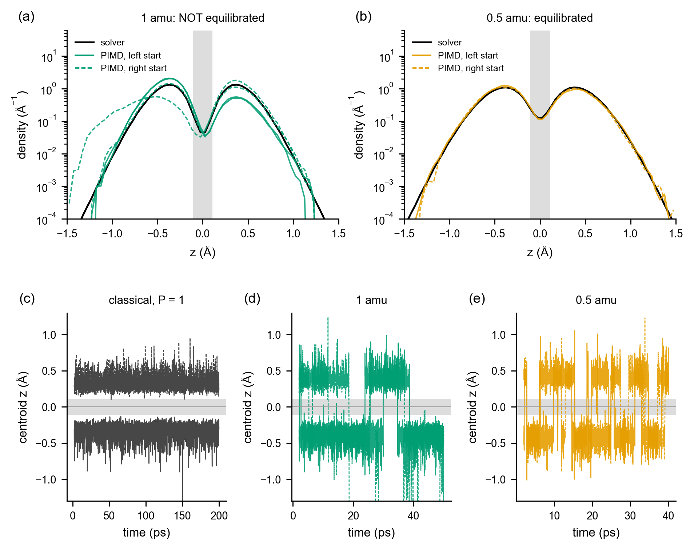
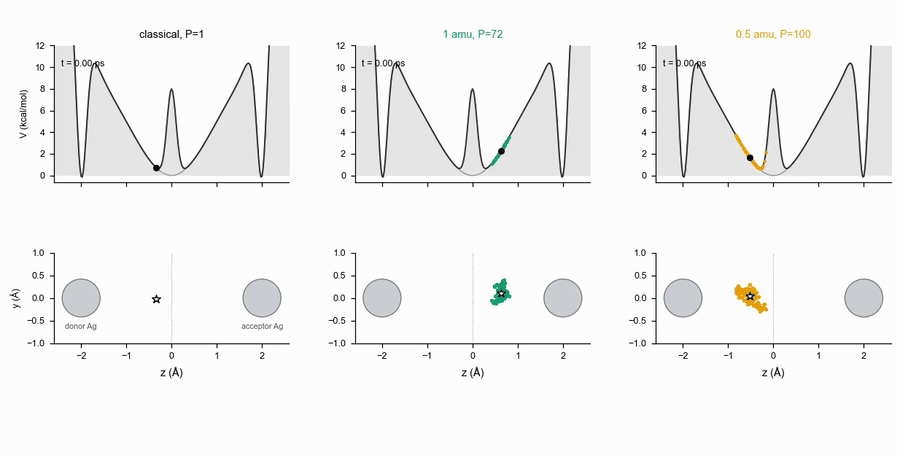
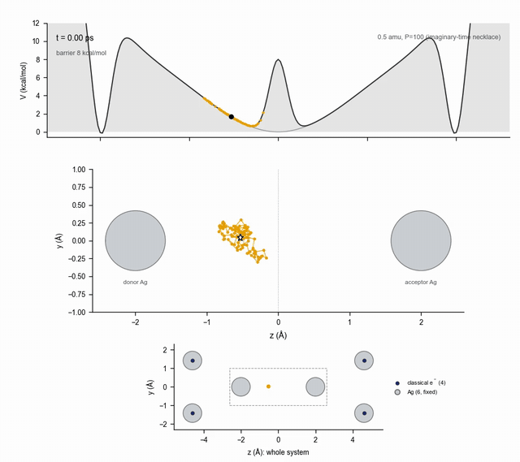
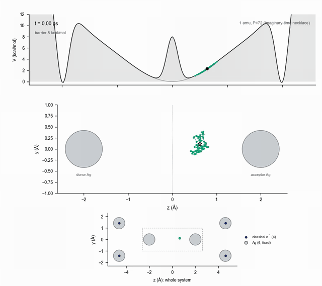

<p align="center">
  
</p>

# PI-eReaxFF

**What if an electron in a molecular-dynamics simulation could behave like a quantum particle, and still be cheap enough to simulate for nanoseconds?**

This project tries to make that real. It lets an electron tunnel through a barrier, spread out, and "leak" across a gap, inside a ReaxFF-style force field, using path-integral molecular dynamics.

> **Status in one line:** it works end to end for silver clusters with explicit electrons (Ag/El), and we have checked it against an independent quantum solver. It is not yet a general-purpose engine. [What works and what doesn't](#where-things-stand) is below. The repository is private and the license is undecided.

---

## The big picture

**ReaxFF** is a fast way to simulate chemistry: atoms, bonds that form and break, charges. It treats every atom classically.

**eReaxFF** adds one trick. Some electrons become particles of their own (type `El`) that move around between atoms. Now the model can describe things plain ReaxFF cannot: conduction electrons, electron transfer, an electron sitting in a gap.

But an electron is light, and a light particle is not a classical dot. It is smeared out, and it can slip through barriers it doesn't have the energy to climb. A normal simulation misses all of that.

**Path-integral molecular dynamics (PIMD)** fixes it with a neat trick. Replace each quantum particle with a **necklace of beads** joined by springs:

```
   classical particle            quantum particle (a ring polymer)

          •                            •───•───•
                                     •           •
     one point,                      •           •      the more spread out the necklace,
     one place                         •───•───•        the more "quantum" the particle

   a light particle = a big floppy necklace;  a heavy one = a tight little clump
```

Simulate the necklace with ordinary dynamics and you get the quantum statistics of the particle (zero-point motion, tunneling, delocalisation), for the cost of running many copies of the classical system.

**This repository connects the three pieces:**

```
        i-PI                     LAMMPS + Metal-Reax                eReaxFF force field
   (moves the beads,   <--->   (computes forces on every   <--->   (the physics: atoms, ions,
    keeps temperature)          bead, fast)                          explicit electrons)
```

- **i-PI** is the well-known PIMD driver. We added one feature: some atoms (the silver ions) can stay classical while the electron is a necklace.
- **Metal-Reax** is a fast ReaxFF engine written in C++. We added an eReaxFF mode, checked term by term against the original Fortran code.
- **The glue**: scripts, quantum solvers for cross-checking, and a pile of validation reports.

## Why bother?

The motivating problem is **electron leakage across thin barriers** (think silicon devices). Classical simulations say the electron stays put. Reality says it leaks. A force field with a PIMD electron should capture that. Before trusting it on silicon, we needed a clean test where the right answer is known. That is the demonstration below.

## The story so far: can a simulated electron tunnel?

### Chapter 1: the stage

We built the smallest system that has the physics we care about: **two silver triangles facing each other across a 4.0 Å gap**, with **one quantum electron** that can sit on either side. Six silver atoms are held fixed, four more electrons sit on the outer atoms as ordinary classical particles, and the fifth electron is a ring polymer (a necklace of beads, see above).


*Fig. 1. (a) The six fixed Ag atoms (grey), four classical electrons (blue rings) on the outer atoms, and the one quantum electron (orange), which starts at the left inner silver atom and is free to move along the axis. (b) The energy the electron feels along the axis: a narrow pit at each inner silver atom (z = ±1.975 Å), a 10.5 kcal/mol barrier on each side of the pit, and a broad shallow well in the middle. (c) Zoom on the middle, showing the Gaussian barrier we later add at z = 0.*

### Chapter 2: our first idea did not work (and that was informative)

The force field already has a built-in 10.5 kcal/mol barrier between each pit and the middle, so we hoped the electron would sit in one pit and tunnel to the other. Before running anything expensive, we asked the quantum solver where the electron actually wants to be.


*Fig. 5. (a) Equilibrium density along the axis from the 3-D Schrödinger solver, for four electron masses, against a classical electron (dashed). The quantum electron sits in the broad middle region at every mass, and so would a classical electron at equilibrium (only 0.7 % of its weight is in the pits). A classical simulation started in a pit never leaves it, though, because it is a kinetic trap. (b) Probability of being found at the pits. At 4 amu this is a genuine pit state (hatched bar: its Boltzmann weight). At 0.1 amu it is only the tail of the middle wavefunction, which is why two very different electrons give similar bars. The 1 amu solver bar is an underestimate because the solver stops at 14 kT above the ground state.*

The simulations agreed: started in a pit, the 1 amu ring left within about 0.8 ps and the 0.5 amu ring within about 0.02 ps, and none came back. So the pit is not where a quantum electron lives, and there was no barrier penetration to measure. We recorded this and moved on, rather than tuning until something looked good.

### Chapter 3: design a barrier with the solver first

We added a narrow Gaussian barrier in the middle (3 kcal/mol high, 0.10 Å wide) and scanned 12 designs on the solver alone, before any simulation. This is the only design that satisfied all our criteria at 1 amu: the quantum ground state sits 2.5 kT below the barrier top, the quantum density at the barrier is about 12 times the classical value, and the classical barrier is about 4 to 5 kT.

#### How the Schrödinger solver works (and why we trust it)

The solver is the *reference answer* we compare the simulation against. It solves the quantum problem directly, with no random sampling, so any disagreement points at the simulation.

**The question it answers.** Take the one quantum electron, mass *m*, and hold everything else still: the six silver atoms are fixed and the four classical electrons are frozen on their silver ions. The electron then moves in a fixed energy landscape *V(x, y, z)*, and quantum mechanics says its behaviour at temperature *T* follows from the time-independent Schrödinger equation:

```
[ -ħ²/(2m) ∇²  +  V(x, y, z) ] ψₙ = Eₙ ψₙ
```

Once we have the energy levels *Eₙ* and wavefunctions *ψₙ*, the thermal density along the axis is a weighted sum over states, with the usual Boltzmann weights:

```
ρ(z)  =  Σₙ exp(-(Eₙ - E₀)/kT) · ∫|ψₙ|² dx dy   /   Σₙ exp(-(Eₙ - E₀)/kT)         (T = 300 K)
```

A *classical* electron in the same landscape has the plain Boltzmann density exp(-V/kT), and we compute that too, from the same potential, for the dashed lines in the figures.

**Where the landscape comes from.** The potential *V* is not a model we made up for the solver. We place the electron at every point of a 3-D grid and ask the actual simulation engine (LAMMPS with the Metal-Reax eReaxFF pair style) for the total energy there. So the solver and the path-integral simulation use *exactly the same force field*. That is the point: this comparison tests whether the **path-integral machinery** (i-PI, the bead bookkeeping, the thermostat, the engine) reproduces the quantum answer. It does not test whether the force field itself matches real silver.

**How it is solved numerically** (`inputs/tunneling_ag/schrod3d.py`).
1. A cell-centred grid with spacing *h* = 0.03 Å (0.04 Å for the 4 amu case), covering |x|, |y| ≤ 1.2 Å and |z| ≤ 3.0 Å.
2. The landscape is mirror-symmetric in x, y and z, so only x, y ≥ 0 is solved, as four separate symmetry sectors (even or odd in x, even or odd in y). This cuts the size of the problem by four.
3. The kinetic term is a second-order finite difference, so the Hamiltonian is a large sparse matrix. We find its lowest eigenvalues with a sparse eigensolver (`scipy.sparse.linalg.eigsh`).
4. We keep asking for more states until we have reached **14 kT above the ground state**, so the thermal sum is complete to that cutoff.
5. Barrier designs are added on top of the measured landscape as *V0 exp(−z²/2σ²)* (`schrod3d_barrier.py`), and each design reports the numbers listed next.

**What it reports for each electron mass.** The ground-state energy; the *margin* (how far the ground state lies below the top of the barrier, counting the transverse zero-point energy at the barrier, in kT); the quantum and classical density at z = 0 and their ratio; the **tunnel splitting** (the energy gap between the lowest even-in-z and odd-in-z states, a direct measure of how strongly the two sides are coupled); and the classical barrier height as a free-energy difference.

**How we got here.**
- We first solved a **1-D** version on a scan of the energy along the axis (`schrod1d.py`). It showed the pit is strongly anharmonic (a harmonic pit would give 39 kcal/mol at the position where the real landscape gives 10.5).
- We then moved to the full **3-D** problem, because the sideways zero-point energy of a light electron is as large as the barrier itself, so a 1-D axis scan gives the wrong picture.
- The 3-D solver is checked in two ways. Refining the grid from 0.04 to 0.03 Å changed the density ratio by about 4 % and the ground-state energy by 0.3 % (for the chosen barrier design). And a first path-integral run with the other four electrons frozen (matching the solver's assumption) reproduced the solver's rms width of the density (0.2546 ± 0.010 Å against 0.2532 Å) on the force field's own barrier.

**What it does not capture (limits, stated plainly).**
- The other four electrons are frozen in the solver but free to move in the simulation. Small differences in the density tails (we see 9 to 25 % at 1 amu) are expected from this, but we have not proved that explanation.
- Second-order finite differences and a finite box: the 0.1 amu result carries about 1 % box-size error, and the 4 amu pit is narrow enough that the 0.04 Å grid is marginal.
- The thermal sum stops at 14 kT, which leaves out the 1 amu pit state (16.4 kT up). That is why one bar in Fig. 5b is an underestimate.
- It treats one electron only. It gives equilibrium (thermal) quantities, not real-time dynamics.

Code: [`inputs/tunneling_ag/schrod3d.py`](inputs/tunneling_ag/schrod3d.py), [`schrod3d_barrier.py`](inputs/tunneling_ag/schrod3d_barrier.py), [`schrod1d.py`](inputs/tunneling_ag/schrod1d.py). The landscape evaluation needs the LAMMPS engine, so the grids are not recomputed here; the stored results are in `validation/tunneling_ag/data/`.

### Chapter 4: does the simulation agree with the solver?

Yes, for all four masses, once enough beads are used.


*Fig. 2. Electron density along the axis from path-integral MD (circles) against the Schrödinger solver (line) and a classical electron (dashed), at 4, 1, 0.5 and 0.1 amu. Panel (e) shows the ratio of PIMD to solver for four observables. Error bars are block errors and are optimistic.*


*Fig. 3. The lighter the electron, the more it spreads over the barrier. (a) How much more likely the electron is to be found at the barrier than a classical electron: PIMD 2.8, 6.5, 8.9 and 11.0 at 4, 1, 0.5 and 0.1 amu, against solver 2.6, 5.9, 8.4 and 10.4. (b) The width of the distribution. (c) How far the ground state sits below the barrier top. At 0.1 amu the margin is only 1 kT, so we call that zero-point delocalisation over the barrier rather than tunneling.*


*Fig. 4. Checks that the answer does not depend on the numerical settings. At 0.5 amu, 50 beads was not enough (the width and tails were off by about 3σ) and 100 beads fixed it. At 1 amu, doubling the beads and halving the timestep changed the barrier-region density by +0.6 % and −4 %, within the statistical error.*

### Chapter 5: watch it happen

These movies show the electron as the necklace the method actually simulates. The silver atoms are drawn, and the four classical electrons sit on the outer ones.


*Movie 1. A 1 amu electron (36 beads) in the barrier region. Top: the potential along the axis with the beads placed on it. Middle: the necklace between the two inner silver atoms (donor and acceptor); the star is the centroid and the grey line is its path. Bottom: the whole system. Full quality: [`assets/movies/anim_A_1amu_ag.mp4`](assets/movies/anim_A_1amu_ag.mp4).*


*Movie 2. The same barrier seen by a heavy (4 amu), a medium (1 amu) and a very light (0.1 amu) electron, and by a classical point electron. The heavy electron is a tight clump, the light one is a large floppy necklace that spreads over the barrier. Over the runs these were taken from, the fraction of time a necklace straddles the barrier is 2.7 %, 22.5 % and 94 % (4, 1, 0.1 amu). Full quality: [`assets/movies/anim_B_compare_ag.mp4`](assets/movies/anim_B_compare_ag.mp4).*


*Fig. 7. Six snapshots of the 1 amu necklace approaching, straddling and crossing the barrier.*

**Please read this caveat.** The necklace is an imaginary-time picture of how spread out a quantum particle is. It is *not* the electron's real-time motion, and the necklace "crossing" the barrier is thermal sampling, not a time-dependent tunneling event. What the movies show is delocalisation: how much of the electron's probability sits on both sides at once.

### Chapter 6: a higher barrier, so a classical electron cannot escape

At 5 kT, a classical electron can still climb over the barrier. So we asked the solver for a taller one: **8 kcal/mol (about 12 kT)**, same width. A classical electron should now stay on the side it started on for nanoseconds, while a light quantum electron should still have probability in the middle. We then ran the simulations on a second machine.



*Fig. 8. Barrier of 8 kcal/mol. (a, b) Electron density along the axis, simulation per run (green and orange; solid for left start, dashed for right start) against the solver (black). (c, d, e) The centroid of the necklace against time for a classical electron, a 1 amu electron and a 0.5 amu electron. The grey band is the barrier region.*

What happened, in plain words:

- **The classical electron stays put.** Two runs of 200 ps each, one started on each side: zero crossings. The closest either came to the middle was about 0.1 Å. (A 200 ps run cannot prove trapping for a barrier whose classical crossing time we estimate at 8 ns or more, only fail to contradict it.)
- **The 0.5 amu quantum electron crosses back and forth,** about 20 times in 40 ps, from either start, and its density agrees with the solver to within 5 to 8 %. This is the clean result. It rests on two runs, so the run-to-run error bar is weak, and we did not run the bead-doubling or half-timestep checks for this barrier.
- **The 1 amu electron is not equilibrated.** In 4 runs of 50 ps it crossed only 3 to 6 times each, spending 5 to 20 ps on one side at a time, and all four spent more time on the left, including the two started on the right. One run fell into the left pit and stayed near it for half the run, which is a kinetic trap (the solver puts the equilibrium weight of that state at about 1e-7). We therefore do **not** call 1 amu an equilibrium profile here. Excluding the pit frames, the other three runs are within 5 to 10 % of the solver, but that exclusion was made after the fact.
- **Not run:** 0.1 amu at this barrier, and the checks above. The conserved quantity is also noisier than at the 3 kcal/mol design.

To see it, here are the necklaces on the 8 kcal/mol barrier. Same conventions as the earlier movies (silver atoms drawn, imaginary-time necklace, not real-time motion), each window 4 ps long.



*Movie 3. A classical point electron, a 1 amu necklace (72 beads) and a 0.5 amu necklace (100 beads) on the 8 kcal/mol barrier. The three panels come from different runs and different times, each stepped in real time from the start of its own window. The classical electron (window with its closest approach to the barrier) stays on one side. The 1 amu and 0.5 amu necklaces are windows in which the centroid crosses the barrier. Full quality: [`assets/movies/anim_B_compare_hb_ag.mp4`](assets/movies/anim_B_compare_hb_ag.mp4).*



*Movie 4. The 0.5 amu electron (100 beads) in a window where it moves between the two sides. Top: the potential with the beads placed on it. Middle: the necklace between the donor and acceptor silver atoms. Bottom: the whole system. This run passes the equilibration check, but it is one of two. Full quality: [`assets/movies/anim_A_0p5amu_hb_ag.mp4`](assets/movies/anim_A_0p5amu_hb_ag.mp4).*



*Movie 5. The 1 amu electron (72 beads) in a window around one of its few crossings. Note that this 1 amu set is not equilibrated (3 to 6 crossings per 50 ps run), so this shows a rare event we picked out, not a typical stretch. Full quality: [`assets/movies/anim_A_1amu_hb_ag.mp4`](assets/movies/anim_A_1amu_hb_ag.mp4).*

The short version: at 12 kT the classical electron never crosses in our runs while the 0.5 amu quantum electron crosses about once per two picoseconds and matches the solver. The 1 amu runs need to be much longer. Full numbers: [`validation/tunneling_ag/HIGHER_BARRIER_PIMD.md`](validation/tunneling_ag/HIGHER_BARRIER_PIMD.md).

### Chapter 7: what is next

- **Production statistics at the 3 kcal/mol design.** Six 1 amu runs of 50 ps agree with the earlier results on width and tails; the barrier-centre density is 3 to 5 % low and not yet explained, so more runs and the 0.5 and 4 amu sets are in progress. See [`STAGE3_PRODUCTION.md`](validation/tunneling_ag/STAGE3_PRODUCTION.md).
- **Longer 1 amu runs at the higher barrier,** plus bead and timestep checks, and a 0.1 amu set.
- **Silicon.** The point of all this: the same machinery, with a force field for silicon, to study electron leakage.

## How long does a simulation take, and where does the time go?

**Wall-clock times we measured** (one run, single core, up to five runs sharing the machine at once, so an isolated run is somewhat faster):

| Run | Beads (P) | Timestep | Length | Steps | Wall time |
|---|---|---|---|---|---|
| Classical electron | 1 | 0.125 fs | 200 ps | 1.6 M | about 25 min (≈1,060 steps/s) |
| 1 amu quantum electron | 72 | 0.125 fs | 50 ps | 400 k | about 2.2 h (≈50 steps/s) |
| 0.5 amu quantum electron | 100 | 0.09 fs | 50 ps | 556 k | about 3.7 h (≈42 steps/s) |
| 0.5 amu on the 8 kcal/mol barrier (Mac Mini) | 100 | 0.09 fs | 40 ps | 444 k | about 2.9 h |
| 0.1 amu quantum electron (planned, not yet run) | 220 | 0.045 fs | 50 ps | 1.1 M | **an estimate of about 15 to 20 h per run** |

So one quantum run costs hours where a classical one costs minutes, and the full set of runs behind the figures here is dozens of run-hours.

**What takes the time: the number of beads times the number of steps.** Each step needs a force evaluation for every bead, so cost is roughly P times the steps. Both factors are pushed up by the physics:

- *More beads for a lighter electron.* The springs between beads get stiffer as P grows, and the number of beads needed grows roughly like 1 over the square root of the mass. That is why 0.5 amu needs 100 beads (50 failed our check) and 0.1 amu needs 220.
- *Smaller timesteps for the same reason.* The stiff springs are the fastest motion in the system, so the timestep has to shrink: 0.125 fs at 1 amu, 0.045 fs at 0.1 amu.
- *Long runs.* The electron crosses the barrier rarely, so we need tens of picoseconds to see enough crossings. At the 8 kcal/mol barrier, even 50 ps was too short at 1 amu.

**The surprise: the chemistry is not the expensive part.** Measured at P=72 (1 amu), one step takes about 20 ms, and it splits roughly as:

- **about 80 % sockets and process hand-offs** (two socket round trips per bead, polling, a separate driver for the barrier),
- **about 11 % i-PI's own Python** (moving the beads and the thermostat),
- **about 9 % the force field** (about 24 microseconds per bead as called from Python; the bare force call is about 10 microseconds).

**What we already did about it**
- *A redundant step in our i-PI patch* cost about two extra force evaluations per step (about 2x at P=32). Removed.
- *Socket polling delay.* Lowering one number gave +58 % steps per second with bit-for-bit identical results.
- *Running 4 to 12 clients per run* is slightly faster per run but worse per core, so we run several independent runs side by side instead.
- *A second machine* (a 10-core Mac Mini, same binaries, checked to give identical results) for the longer runs.

**What could make it faster (ideas, not tested yet)**
- *Send all beads of a step in one batch.* **Tested: about 5 times faster.** We replaced the socket clients with one i-PI direct force field holding a single LAMMPS instance that evaluates every bead in one call. Same setup, interleaved repeats on a loaded machine: 50 to 256 steps/s at P=72 (5.1x), 36 to 189 at P=100 (5.3x), 15 to 91 at P=220 (6.2x). Forces on 793 bead configurations agree with the socket version to 3e-12 kcal/mol/A, and a same-seed 400-step run agrees to about 3e-6 eV. Not yet done: a long statistical comparison, a restart test, and a proper option in the run script. Details: [`validation/phase3_engine/BATCHING_TEST.md`](validation/phase3_engine/BATCHING_TEST.md). With the bare force the ceiling at P=72 is about 6.8x, so going further needs i-PI's own Python sped up too.
- *Move the bead propagation out of Python* (or run i-PI's work on fewer, vectorised calls).
- *Fewer beads for the same accuracy*, using a higher-order path-integral factorisation or ring-polymer contraction. We have not tried these, and they must be re-validated against the solver.
- *Longer timesteps* by multiple-time-stepping, which helps when the forces are expensive. Here they are cheap, so we expect little gain.
- *Write less output*, since the bead trajectory files dominate disk use (the 0.1 amu plan writes every 600 steps, in 10 ps segments).

## Along the way, things we found and fixed

- **A hidden jump in the original code**: a tiny energy jump whenever two silver atoms drift across a 5 Å cutoff, built into the original code. It made long runs with moving atoms drift. We found it, measured it, and added a "smooth" setting that removes it.
- **About a 2× speed-up** from removing a redundant step in our i-PI patch (P=32).
- **A 58 % speed-up** from one number (the socket polling delay), with bit-for-bit identical results.
- **A cost surprise**: one force evaluation takes about 10 microseconds. i-PI's communication overhead is 20× larger. Speed now lives in the plumbing, not the physics.

## Where things stand

| | |
|---|---|
| **Works and is validated** | Ag/El with fixed charges; eReaxFF terms match the original code to 1e-10 or better; i-PI classical-atoms patch passes its tests; PIMD agrees with the quantum solver (above) |
| **Works with caveats** | "Smooth" setting is for Ag/El only; periodic boxes need edges of at least 2 × bond cutoff + 1 Å |
| **Not done / known problems** | Fixed charges only (no charge equilibration with electrons); only C, El and Ag are supported; graphene runs collapse after about 110 fs (cause unknown); the i-PI patch is not yet submitted upstream; one test is at 63 of 64; scripts expect the original folder layout |
| **In progress** | A production-quality version of the tunneling study (more runs, error bars from independent runs) |

## Try it

Honest warning: the scripts were written for a particular folder layout and have not been re-run from a fresh clone, so expect to fix a few paths. The steps, in short:

1. Apply the i-PI patch (`ipi/patches/`) to i-PI at commit `93162d2`.
2. Build the pair style (`pair_style/`) as a LAMMPS plugin.
3. Run one electron between two silver clusters:
   `python3 inputs/tunneling_ag/run_barrier_lammps.py --help`
4. Run every check in one go: `python3 tools/run_all_checks.py`

Exact commands, flags and the full reproduction recipe are in **[docs/TECHNICAL.md](docs/TECHNICAL.md)**.

## Map of the repository

| Folder | What's in it |
|---|---|
| `pair_style/` | The Metal-Reax engine with the eReaxFF mode |
| `ipi/` | The i-PI patch (classical atoms next to quantum ones) |
| `drivers/`, `inputs/`, `tools/` | Glue code, run scripts, the Ag/El setup, solvers, one-command check runner |
| `validation/` | Every validation report, in order, with the evidence |
| `docs/` | Technical reference, the build plan, the audit of the earlier code, status log |
| `legacy_derived/` | Small patches against the original Fortran code. Restricted; see below |

## Good to know

- **License:** undecided. Some content derives from the original group code, so public release is not decided. Keep the repository private for now.
- **The force field** is the published Ag/El set from Evangelisti, Fichthorn and van Duin, *J. Chem. Phys.* **153**, 104106 (2020).
- Built on [i-PI](https://github.com/i-pi/i-pi), [LAMMPS](https://www.lammps.org) and [Metal-Reax](https://github.com/yeatanir/Metal-Reax).
